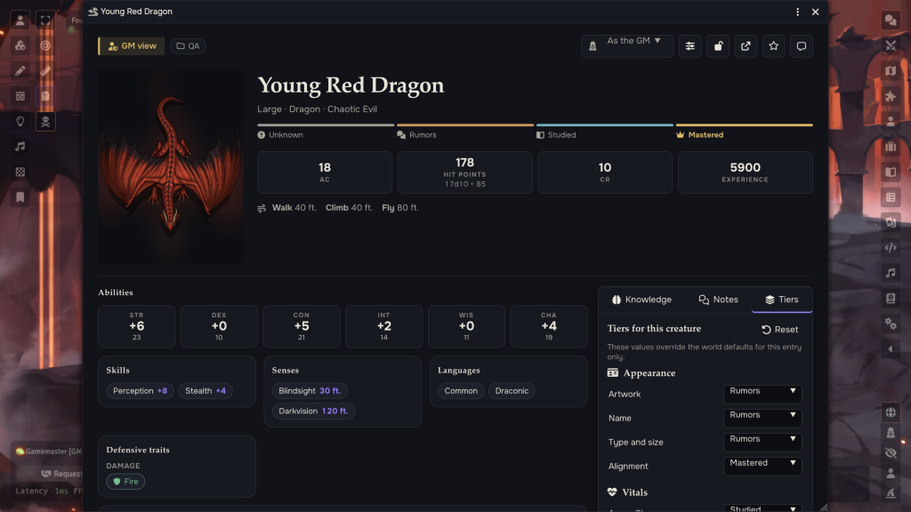
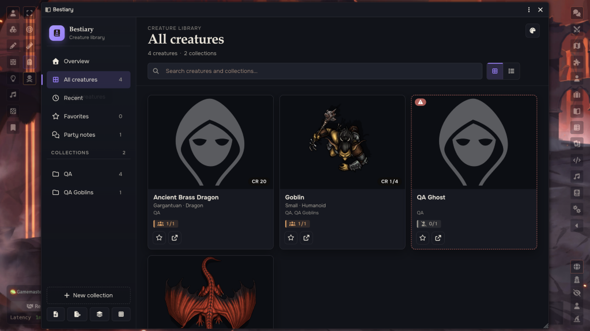
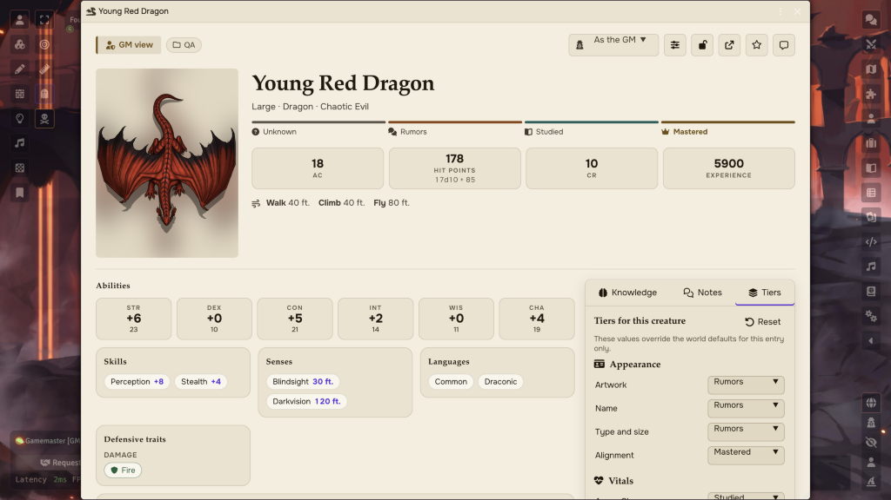

<div align="center">

**English** · [Русский](README.ru.md)

# Bestiary Journal

**A visual bestiary for Foundry VTT and D&D 5e with per-player knowledge tiers, creature collections, party notes, and GM authority**

Track what each player has learned about every monster across customizable research tiers, share notes cleanly, and reveal statblocks at the pace of your campaign.

[](https://github.com/TacticalOtaku/BestiaryJournal/releases/latest)
[](https://github.com/TacticalOtaku/BestiaryJournal/actions/workflows/ci.yml)
[](https://foundryvtt.com/)
[](https://github.com/foundryvtt/dnd5e)
[](lang/)
[](LICENSE)

[Installation](#installation) · [Screenshots](#screenshots) · [Quick Start](#quick-start) · [Features](#features) · [Entry Points](#entry-points) · [Settings](#settings) · [Development](#development)

</div>

---

## Installation

In Foundry VTT (**Setup → Add-on Modules → Install Module**), paste the **Manifest URL**:

```text
https://github.com/TacticalOtaku/BestiaryJournal/releases/latest/download/module.json
```

**Requirements:** Foundry VTT **14.367+** (maximum `14`), D&D 5e **`5.3.3+`**.  
**Manual install:** Download `bestiary-journal-v<version>.zip` from [GitHub Releases](https://github.com/TacticalOtaku/BestiaryJournal/releases/latest), extract it into `Data/modules/bestiary-journal` (with `module.json` at its root), and enable **Bestiary Journal** under **Manage Modules**.

---

## Screenshots





---

## Quick Start

1. Open the bestiary with `Shift + B` or the **Journals** tab header button.
2. Create a collection and optionally organize families inside it.
3. Populate it by dragging NPCs or actor folders, or using **Bulk Import**.
4. Open a creature card and adjust block reveal thresholds on the **Tiers** tab if needed.
5. Assign starting tiers on the **Knowledge** tab (or via **Party Knowledge**), or let players discover details through research rolls.

### Upgrading from `0.1.x`

An automatic migration runs once when an active GM enters the world, preserving backups before writing:

- **Custom** detail mode maps to per-block reveal threshold overrides (**GM Only** for disabled blocks);
- global detail settings (when **GM Only** was enabled) convert into per-player starting tiers.

---

## Features

### Research & Knowledge Tiers

Creature knowledge is tracked per player along a customizable research ladder (4 built-in tiers by default, expandable up to 10):

| Default Tier | Revealed by default                                                                                                                           |
| ------------ | --------------------------------------------------------------------------------------------------------------------------------------------- |
| **Unknown**  | Silhouette instead of portrait; name, creature type, and statistics hidden                                                                    |
| **Rumors**   | Portrait, name, creature type, and size                                                                                                       |
| **Studied**  | AC, HP, CR, speed, ability scores, skills, senses, languages, damage resistances, traits, and actions                                         |
| **Mastered** | Alignment, XP, immunities, vulnerabilities, damage modifiers, condition immunities, bonus/legendary actions, reactions, spells, gear, and bio |

- **Custom tiers:** GMs can add custom research tiers (between default tiers or beyond **Mastered**), rename or edit hints, choose FontAwesome icons and WCAG-verified accent colors, reorder tiers, or remove them. Existing creature and player progress remaps automatically when tiers change.
- **Knowledge management:** GMs set tiers for individual players in the creature card, grant a creature's tier to the whole party in one click, or manage the full matrix (with name search, family filter, and multi-select batch updates) via the **Party Knowledge** board.
- **Research rolls:** Players roll Nature, Arcana, Religion, Perception, or another allowed skill directly from the creature card; success raises their tier by one. Research DC derives from CR or is set by the GM.
- **GM authority:** Research rolls are judged by the active GM client (verifying message author, character ownership, skill eligibility, freshness, and single-use consumption) and posted to chat respecting what recipients know.
- **Flexible reveal thresholds:** Customize which blocks appear at each tier globally and per creature; hide or lock individual actions, reactions, and spells down to **GM Only**.
- **End-to-end privacy & preview:** Knowledge tiers filter the library, collections, filters, search, and chat cards; GMs can toggle **"Preview as player"** to inspect any card from a player's point of view.

### Visibility & Locking Controls

- Hide individual **collections**, **families**, or **creatures** from players.
- **Locking** a collection or entry freezes tier changes and notes until unlocked by the GM.
- Unidentified creatures whose names are unknown are grouped separately for players so family names do not spoil their nature; DC and skill hints also withhold hidden CR and creature type.

### Notes & Knowledge Sharing

- **Three note channels** on every creature card: **GM** (with a per-note visibility toggle), **Party** (shared), and **Personal** (visible only to its author, including GMs). Supports `@UUID`, `@Check`, inline rolls, and pinned notes.
- **Party Notes feed** in the library gathers notes across all creatures accessible to the player.
- **Knowledge sharing** lets players share studied details up to their own tier (never lowering another player's tier). GMs control when sharing is permitted: **Always**, **Out of combat**, or **After a rest** following the last combat.

### Collections, Families, Bulk Import & Research Config

- **Unified workspace & families showcase:** Collections open inside the main window with a persistent collections sidebar, a **Cards / List / Families** switcher, visual family banners with cover art and progress bars, drag-and-drop between families (including directly onto large family showcase cards), and filtering by family, type, size, or CR.
- **Bulk research configuration:** Update research DC and allowed skills across a collection, family, or the whole bestiary while preserving locked entries.
- **Bulk import & portability:** Import NPCs from world actors and compendiums (with filters and optional world-actor copying), drop actor folders straight into a collection, and export/import structure & knowledge as JSON (`merge` or `replace all`).

### Interface & Artwork

- **Look drawer** inside the library and collections (user & client preferences): **Night**, **Parchment**, **Auto**, and **Match AIM** (integrates with _AIM: Actor Window_), 6 accent colors, 2 density modes (**Comfortable** / **Compact**), 3 collection cover sizes (**Small** / **Medium** / **Large**), and motion levels respecting OS reduced-motion and Foundry low-performance mode.
- **Bundled typography:** Built on the unified **Onest** variable font (`Latin` + `Cyrillic`) across headings, UI, and tabular numeric metrics.
- **Smart framing & animated art:** Unknown creatures display a custom archival silhouette tailored for dark and light themes; collection covers show the full artwork over a blurred backdrop; creature portraits and tokens support focal-point cropping, and animated GIF/WebP art plays on hover or keyboard focus.

### Built for GMs & Players

| For Gamemasters                                                       | For Players                                            |
| --------------------------------------------------------------------- | ------------------------------------------------------ |
| **Party Knowledge** board (`creature × player`)                       | **New** badge and notifications on tier advances       |
| **Bestiary…** menu in Actor Directory, NPC sheet (`⋮`), and Token HUD | Personal progress bars on collection covers            |
| Party-wide progress on covers & **Encounter Reveal** on combat start  | Separate **Unidentified** group hiding family spoilers |
| Clean reference statblocks without NPC roll clutter                   | Share creature cards to chat capped by party knowledge |

---

## Entry Points

| Entry Point          | Where to find it                                                                       |
| -------------------- | -------------------------------------------------------------------------------------- |
| **Keybinding**       | `Shift + B` by default (rebindable under _Configure Controls_)                         |
| **Journals sidebar** | Header button in the **Journals** tab                                                  |
| **Actor actions**    | **Bestiary…** in the Actor Directory context menu, NPC sheet `⋮` menu, and Token HUD   |
| **Chat cards**       | **Send to Chat** on a creature card or **Post Party Knowledge** from a collection menu |
| **Module Settings**  | _Configure Settings → Module Settings → Bestiary Journal_                              |
| **Macros & modules** | Public API `game.bestiaryJournal` — see [API.md](API.md)                               |

---

## Settings

### World Settings (GM-only)

| Setting                      | Default       | Purpose                                                                                                        |
| ---------------------------- | ------------- | -------------------------------------------------------------------------------------------------------------- |
| **Allow player sharing**     | On            | Enable or disable knowledge sharing between players                                                            |
| **When players can share**   | Out of combat | `Always`, `Out of combat`, or `After a rest` following the last combat                                         |
| **Research by roll**         | On            | Allow raising tiers via skill checks from creature cards                                                       |
| **Single attempt per entry** | Off           | Lock retries after a failed research roll until reset by the GM                                                |
| **Encounter reveal**         | Off           | Grant players the configured encounter tier (by default **Rumors**) when fighting a visible enemy bestiary NPC |
| **Encounter reveal tier**    | Rumors        | Research tier granted when **Encounter reveal** triggers                                                       |
| **Reveal hidden mid-combat** | On            | When **Encounter reveal** is on, also grant knowledge immediately if a hidden enemy is revealed mid-combat     |
| **Include custom skills**    | Off           | Include non-standard skills from `CONFIG.DND5E.skills` in research options                                     |
| **Research tiers**           | —             | Manage custom research tiers (names, hints, icons, colors, order) and global reveal thresholds per section     |

### Client Settings & Appearance

- **Show guide & contextual hints** (user setting, on by default) — opens the interactive walkthrough once on first open and displays quick-tip banners and inline hints (reopen anytime via `?` or **Guide & tips**).
- **Debug logging** (client setting, off by default) — detailed diagnostics in the browser console.
- **Window appearance** — theme, accent, density, cover size, and motion level are configured via the palette button in the library window.

> [!NOTE]
> **Foundry VTT Architectural Note**
> Private notes and unshared GM notes are stored in hidden, permission-scoped `JournalEntry` documents enforced by Foundry's server (`NONE` default ownership / per-author `OBSERVER`), so players cannot read other players' private notes or hidden GM notes via the console. However, world settings (`bestiaryData`, `bestiaryKnowledge`), `Party`-shared notes, and world actors synchronize to connected clients, so avoid storing critical spoilers for console-inspecting players in world actor sheets or `Party`-channel notes.

---

## Development

Requires **Node.js 24+** (zero build step or runtime dependencies). GitHub Actions runs [ci.yml](.github/workflows/ci.yml) on Node.js 24 and 26; tagged releases (`v*`) publish the ZIP archive and `module.json` via [release.yml](.github/workflows/release.yml).

```bash
npm install
npm run check    # ESLint, manifest/import/locale validation, and unit tests
npm run deploy   # Copy module into Foundry Data/modules/bestiary-journal
npm run package  # Build release archive into dist/bestiary-journal-v<version>.zip
npm run release  # Run check + package
```

### Project Docs

| Document                                     | Purpose                                                             |
| -------------------------------------------- | ------------------------------------------------------------------- |
| [API.md](API.md)                             | Public API `game.bestiaryJournal` and `bestiaryJournalRefresh` hook |
| [CHANGELOG.md](CHANGELOG.md)                 | Detailed version history                                            |
| [docs/architecture.md](docs/architecture.md) | Layers (`core`, `integrations`, `foundry`, `ui`), stores, and flow  |
| [docs/live-check.md](docs/live-check.md)     | Manual Foundry QA checklist and `tools/live-check.js`               |
| [GLOSSARY.md](GLOSSARY.md)                   | Project domain glossary                                             |
| [CONTRIBUTING.md](CONTRIBUTING.md)           | Issue reporting guidelines                                          |

---

## AI Disclosure

AI-assisted tools were used during development for tasks such as code drafting, refactoring, tests, documentation, and localization drafts. All architecture, code, behavior, user-facing copy, and Russian/English translations are reviewed, tested, and maintained by **TacticalOtaku**, who retains sole authorship and responsibility for the module.

All bundled package assets and user-facing materials comply with Foundry VTT's [AI Content Policy](https://foundryvtt.com/article/ai-policy/) — no pre-generated AI art, audio, or lore assets are included.

---

## Feedback & License

Pull Requests are disabled on this repository; bug reports and feature suggestions are welcome via [GitHub Issues](https://github.com/TacticalOtaku/BestiaryJournal/issues) (see [CONTRIBUTING.md](CONTRIBUTING.md)).

Released under the **GNU General Public License v3.0** ([LICENSE](LICENSE)).  
Bundled UI font: [Onest](https://github.com/simpletype-ru/Onest) ([SIL Open Font License 1.1](assets/fonts/OFL-onest.txt)).
