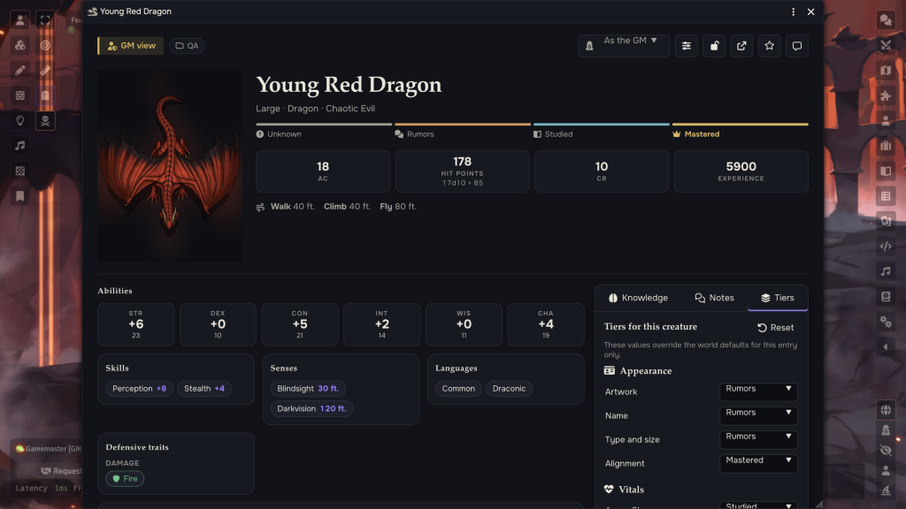
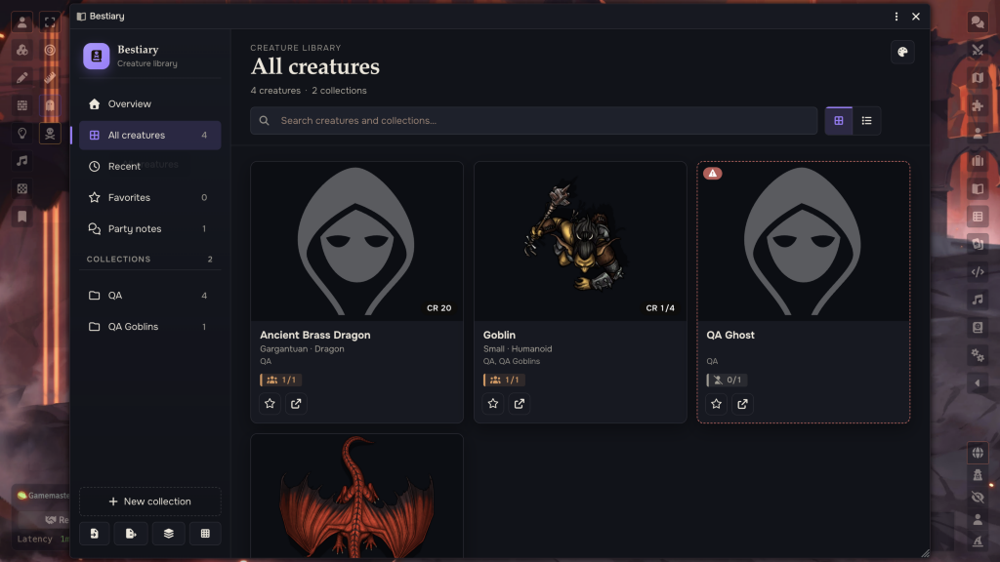
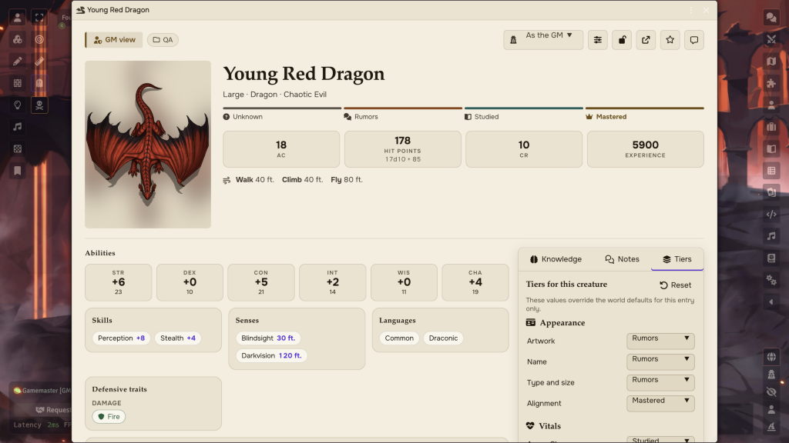

<div align="center">

[English](README.md) · **Русский**

# 📖 Bestiary Journal

**Визуальный бестиарий для Foundry VTT и D&D 5e с персональными ступенями знания, коллекциями существ, заметками и контролем мастера.**

[](https://foundryvtt.com/)
[](https://github.com/TacticalOtaku/BestiaryJournal/releases/tag/v0.5.0)
[](https://github.com/foundryvtt/dnd5e)
[](LICENSE)

[Возможности](#-возможности) · [Способы открытия](#-способы-открытия) · [Настройки](#-настройки) · [Установка](#-установка) · [Быстрый старт](#-быстрый-старт) · [Разработка](#-разработка) · [История изменений](CHANGELOG.md)

</div>

---

## 🖼️ Скриншоты





---

## ✨ Возможности

### 🧠 Ступени исследования и знания

Знания о существе персональны для каждого игрока и выстраиваются по настраиваемой шкале ступеней (4 базовые по умолчанию, можно расширить до 10):

| Ступень (по умолч.) | Что открыто по умолчанию                                                                                                                                                     |
| ------------------- | ---------------------------------------------------------------------------------------------------------------------------------------------------------------------------- |
| **Неизвестно**      | Силуэт вместо портрета; название, тип и характеристики скрыты                                                                                                                |
| **Слухи**           | Портрет, название, тип и размер                                                                                                                                              |
| **Изучено**         | КД, хиты, ПО, скорость, характеристики, навыки, чувства, языки, сопротивления, особенности и действия                                                                        |
| **Досконально**     | Мировоззрение, опыт, иммунитеты, уязвимости, модификаторы урона, невосприимчивость к состояниям, бонусные и легендарные действия, реакции, заклинания, инвентарь и биография |

- **Кастомные ступени** — мастер может добавлять собственные ступени (между стандартными или выше «Досконально»), менять названия и подсказки, выбирать иконку FontAwesome и цвет акцента из палитры с проверенным контрастом, переставлять или удалять ступени. Прогресс существ и игроков пересчитывается автоматически.
- **Управление знаниями** — мастер задаёт ступень отдельным игрокам в карточке существа, всей партии одной кнопкой или массово через таблицу **«Знания отряда»**.
- **Исследование броском** — игрок проверяет Природу, Магию, Религию, Восприятие или другой разрешённый навык прямо из карточки; успех повышает ступень на одну. Сложность берётся от ПО или задаётся мастером.
- **Авторитет мастера** — броски проверяет активный клиент мастера (сверяет автора сообщения, владельца персонажа, навык, свежесть и однократность броска) и сам публикует итог в чат с учётом того, что знают получатели.
- **Гибкие пороги** — состав каждой ступени настраивается глобально для мира и отдельно для каждого существа; отдельные действия, реакции и заклинания можно скрыть или привязать к своей ступени (вплоть до «Только мастеру»).
- **Сквозная приватность и предпросмотр** — ступени действуют в библиотеке, коллекциях, фильтрах, поиске и карточках в чате; мастер может включить режим **«глазами игрока»**, чтобы увидеть карточку от лица конкретного участника.

### 🔒 Точный контроль видимости и блокировки

- Скрытие отдельных **коллекций**, **семейств** и **существ** от игроков.
- **Блокировка** коллекции или записи замораживает изменение ступеней и заметок, пока мастер не снимет замок.
- Неопознанные существа без известного имени выносятся у игроков в отдельную группу, чтобы название семейства не выдавало их природу; подсказки сложности и навыков также не раскрывают скрытые ПО и тип.

### 💬 Заметки и 🤝 Обмен между игроками

- **Три канала заметок** на каждой карточке: **Мастер** (с переключателем видимости у каждой записи), **Партия** (общие для всех) и **Личные** (видны только автору, включая мастера). Поддерживаются ссылки `@UUID`, `@Check`, инлайн-броски и закрепление важных заметок.
- **Лента «Заметки отряда»** в библиотеке собирает заметки обо всех доступных игроку существах.
- **Обмен знаниями** позволяет игрокам делиться изученным существом в пределах собственной ступени (понизить чужое знание нельзя). Мастер выбирает, когда обмен разрешён: **Всегда**, **Вне боя** или **После отдыха** после последнего боя.

### 🗂 Коллекции, семейства, импорт и массовые проверки

- **Коллекции и семейства** с перетаскиванием карточек между семействами, контекстным меню, фильтрами (семейство, тип, размер, ПО), сортировкой и переключением «плитка / список».
- **Массовая настройка проверок** — изменение сложности и допустимых навыков сразу для коллекции, семейства или всего бестиария с сохранением заблокированных записей.
- **Массовый импорт и перенос** — добавление NPC из актёров мира и компендиумов (с фильтрами и опцией копирования в мир), перетаскивание папок актёров прямо в коллекцию, а также экспорт/импорт структуры и знаний в JSON (`дополнить` или `заменить всё`).

### 🎨 Интерфейс и иллюстрации

- **Панель вида** в библиотеке (настройки пользователя и клиента): темы **«Ночь»**, **«Пергамент»**, **«Авто»** и **«Как в AIM»** (совместно с _AIM: Actor Window_), 6 акцентных цветов, 2 режима плотности (**«Обычно»** / **«Компактно»**), 3 размера обложек коллекций (**«Малые»** / **«Средние»** / **«Крупные»**) и управление анимациями (с учётом системной настройки уменьшения движения и режима низкой производительности Foundry).
- **Встроенная типографика** — интерфейс на базе шрифта **Onest** (с поддержкой кириллицы) и **Palatino** для латинских заголовков.
- **Аккуратное кадрирование и анимации** — плитки коллекций в универсальном квадратном формате показывают обложку целиком поверх мягкого размытого фона, с адаптивными подписями под изображением; портрет или токен существа можно кадрировать по точке фокуса. Анимированные изображения (GIF / WebP) оживают при наведении или фокусе с клавиатуры.

### 🧭 Удобство для мастера и игроков

| Для мастера                                                               | Для игрока                                                |
| ------------------------------------------------------------------------- | --------------------------------------------------------- |
| Таблица **«Знания отряда»** («существо × игрок»)                          | Метка **«новое»** и уведомления при росте ступени         |
| Меню **«Бестиарий…»** в каталоге актёров, листе NPC (`⋮`) и на HUD токена | Персональный прогресс на обложках коллекций               |
| Прогресс всей партии на обложках коллекций и **знакомство в бою**         | Отдельная группа **«Неопознанные»**, скрывающая семейство |
| Справочные статблоки без лишних кнопок бросков за NPC                     | Отправка карточки в чат в рамках знаний всей партии       |

---

## ⌨️ Способы открытия

| Способ                | Где находится                                                                     |
| --------------------- | --------------------------------------------------------------------------------- |
| **Горячая клавиша**   | `Shift + B` по умолчанию (переназначается в _Configure Controls_)                 |
| **Кнопка в журнале**  | Шапка вкладки **«Журналы»**                                                       |
| **Меню актёра**       | Пункт **«Бестиарий…»** в каталоге актёров, в меню `⋮` листа NPC и на HUD токена   |
| **Карточка в чате**   | Кнопка **«В чат»** в карточке или **«В чат (что знают игроки)»** в меню коллекции |
| **Настройки модуля**  | _Configure Settings → Module Settings → Bestiary Journal_                         |
| **Макрос или модуль** | Публичный API `game.bestiaryJournal` — см. [API.md](API.md)                       |

---

## ⚙️ Настройки

### Настройки мира (только мастер)

| Настройка                           | По умолчанию | Назначение                                                                                                      |
| ----------------------------------- | ------------ | --------------------------------------------------------------------------------------------------------------- |
| **Разрешить обмен между игроками**  | Вкл          | Разрешает или отключает передачу знаний между игроками                                                          |
| **Когда игроки могут делиться**     | Вне боя      | `Всегда`, `Вне боя` или `После отдыха` после последнего боя                                                     |
| **Исследование броском**            | Вкл          | Разрешает повышать ступень проверкой навыка из карточки                                                         |
| **Одна попытка на существо**        | Выкл         | Блокирует повторную попытку после неудачи до сброса мастером                                                    |
| **Знакомство в бою**                | Выкл         | В начале боя с видимым враждебным существом из бестиария выдаёт игрокам заданную ступень (по умолчанию «Слухи») |
| **Ступень при знакомстве в бою**    | Слухи        | Ступень исследования, выдаваемая при срабатывании «Знакомства в бою»                                            |
| **Раскрывать скрытых врагов в бою** | Вкл          | При включённом «Знакомстве в бою» также выдаёт знание сразу при снятии скрытности посреди боя                   |
| **Учитывать кастомные навыки**      | Выкл         | Добавляет нестандартные навыки из `CONFIG.DND5E.skills` к исследованию                                          |
| **Ступени исследования**            | —            | Управление кастомными ступенями (названия, подсказки, иконки, цвета, порядок) и порогами открытия блоков        |

### Клиентские настройки и оформление

- **Обучение и контекстные подсказки** (настройка пользователя, вкл. по умолчанию) — один раз открывает интерактивное руководство при первом запуске и показывает панель быстрых советов и подсказки в окнах (можно всегда открыть кнопкой `?` или **«Обучение и советы»**).
- **Отладочный журнал** (настройка клиента, выкл. по умолчанию) — подробные сообщения модуля в консоли браузера.
- **Вид окон** — тема, акцент, плотность, размер обложек и уровень анимаций выбираются прямо в библиотеке через кнопку с палитрой.

> [!NOTE]
> **Архитектурное ограничение Foundry VTT**
> Личные заметки игроков и скрытые заметки мастера хранятся в скрытых документах `JournalEntry` с серверными правами Foundry (`default: NONE` / `OBSERVER` только для автора), поэтому игрок не может прочитать чужие личные или скрытые GM-заметки через консоль. При этом мировые настройки (`bestiaryData`, `bestiaryKnowledge`), общие заметки канала «Партия» и актёры мира по-прежнему синхронизируются с клиентами, поэтому не храните критичные спойлеры для читающих консоль игроков в актёрах мира или общих заметках.

---

## 📦 Установка

### По URL манифеста (рекомендуется)

Вставьте ссылку в окно установки модулей Foundry VTT (_Add-on Modules → Install Module → Manifest URL_):

```text
https://github.com/TacticalOtaku/BestiaryJournal/releases/latest/download/module.json
```

### Ручная установка

1. Скачайте архив последнего релиза со страницы [Releases](https://github.com/TacticalOtaku/BestiaryJournal/releases) или клонируйте репозиторий.
2. Распакуйте/поместите папку `bestiary-journal` в директорию модулей Foundry VTT:
   - **Windows**: `%LOCALAPPDATA%\FoundryVTT\Data\modules\bestiary-journal`
   - **Linux**: `~/.local/share/FoundryVTT/Data/modules/bestiary-journal`
   - **macOS**: `~/Library/Application Support/FoundryVTT/Data/modules/bestiary-journal`
3. Перезапустите Foundry VTT и включите **Bestiary Journal** в настройках модулей мира.

---

## 🚀 Быстрый старт

1. Откройте бестиарий сочетанием `Shift + B` или кнопкой во вкладке **«Журналы»**.
2. Создайте коллекцию и при необходимости добавьте семейства.
3. Наполните её: перетащите NPC или папку актёров, либо откройте массовый импорт.
4. Откройте карточку существа и на вкладке **«Ступени»** при необходимости переопределите пороги блоков.
5. На вкладке **«Знание»** (или через **«Знания отряда»**) выдайте игрокам стартовые ступени либо оставьте исследование через проверки навыков.

### Обновление с версии `0.1.x`

Миграция выполняется автоматически при первом входе активного мастера:

- режим **«Настраиваемый»** переносится в переопределения ступеней (отключённые блоки становятся **«Только мастеру»**);
- глобальный режим детализации (при включённом **«Только для ГМ»**) преобразуется в стартовые ступени для игроков.

Перед записью сохраняется резервная копия для восстановления, а исходные поля не удаляются.

---

## 🛠️ Разработка и обратная связь

Модуль не требует сборки и сторонних runtime-зависимостей; для локальных проверок нужен **Node.js 24+**.

```bash
npm install
npm run check    # ESLint, проверка манифеста/импортов/локалей и unit-тесты
npm run deploy   # Копирование модуля в Foundry Data/modules/bestiary-journal
npm run package  # Сборка ZIP-архива в dist/bestiary-journal-v<версия>.zip
npm run release  # Полная проверка (check) + сборка релиза (package)
```

| Документ                                     | Назначение                                                               |
| -------------------------------------------- | ------------------------------------------------------------------------ |
| [API.md](API.md)                             | Публичный API `game.bestiaryJournal` и хук `bestiaryJournalRefresh`      |
| [CHANGELOG.md](CHANGELOG.md)                 | Подробная история изменений по версиям                                   |
| [docs/architecture.md](docs/architecture.md) | Слои (`core`, `integrations`, `foundry`, `ui`), хранилища и поток команд |
| [docs/live-check.md](docs/live-check.md)     | Чек-лист ручной проверки в работающем Foundry и `tools/live-check.js`    |
| [GLOSSARY.md](GLOSSARY.md)                   | Глоссарий доменных терминов проекта                                      |

Pull Requests в этом репозитории отключены; сообщения об ошибках и предложения принимаются через [GitHub Issues](https://github.com/TacticalOtaku/BestiaryJournal/issues) (см. [CONTRIBUTING.md](CONTRIBUTING.md)).

---

## 📄 Лицензия

Проект распространяется по лицензии **GNU General Public License v3.0** ([LICENSE](LICENSE)).
Шрифт интерфейса — [Onest](https://github.com/simpletype-ru/Onest) ([SIL Open Font License 1.1](assets/fonts/OFL-onest.txt)).
